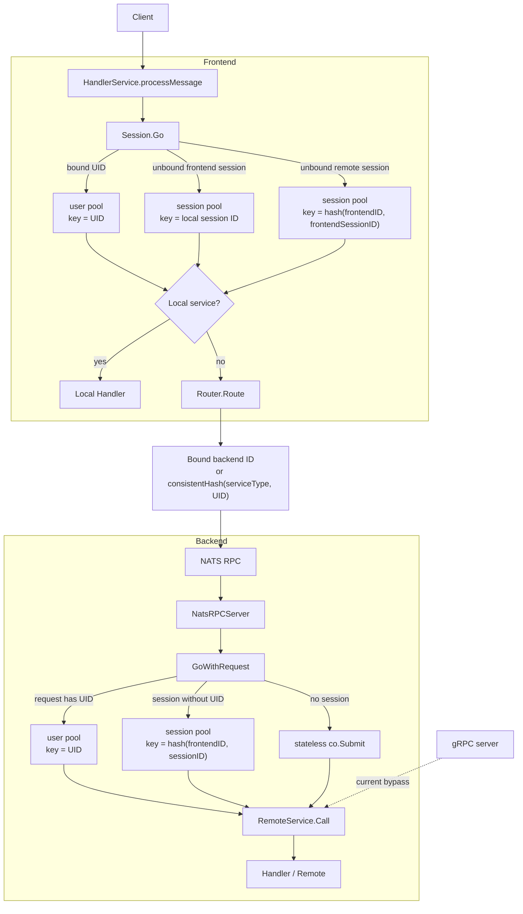
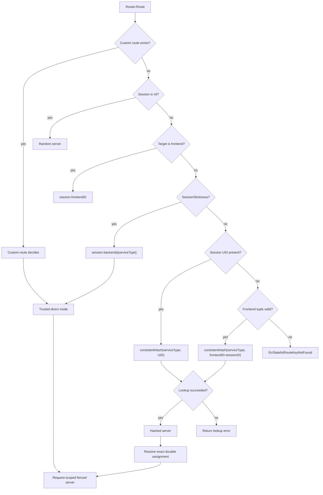
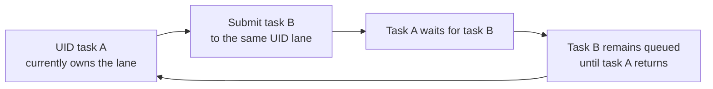

# 按 UID 串行执行：Actor/Keyed Executor 架构

Pitaya 在当前 fork 中按 UID 组织任务队列，并让同一 UID 的请求在一个本地执行域内串行运行。跨服务调用会先按 session 绑定关系或一致性哈希选择 backend，backend 收到 NATS RPC 后再次按 UID 提交任务。这个模型接近 actor 或 keyed executor：UID 是 key，队列是 mailbox，负责消费队列的 worker 是当前 owner。

这里的 actor 只描述调度和所有权，不表示业务状态一定保存在 goroutine 中。Session、组件字段、数据库记录和外部缓存仍由各自模块管理。

当前实现提供的是以下保证：

> 在任务没有触发 running-task escape、请求经过受支持入口，并且相同 key 的提交不是并发发生时，同一 UID 的任务按 backend 实际接纳顺序串行执行。etcd discovery 还会为默认 consistent-hash 选出的 session-bearing point-to-point RPC 解析 exact routing-key assignment，使 hash-ring 视图变化时只有当前 assignment owner 能接纳新请求。

它不提供 exactly-once、跨 UID 事务、多个并发生产者之间的全局顺序，也不会强制终止 owner 切换前已经进入 handler 的旧任务。旧任务的迟到外部写入仍要由业务存储按 fencing epoch 拒绝。

## 设计目标

- 同一 UID 的业务处理在正常路径上不并发，业务组件可以按单写者模型更新用户状态。
- 不同 UID 之间保持并行，慢用户不会阻塞整个服务。
- 同一 UID 在稳态下路由到同一个 backend，不在每个 handler 内竞争分布式互斥锁；etcd assignment admission 本身仍位于 RPC 数据路径。
- 未绑定 UID 的 session 仍按 frontend ID 和 session ID 串行。
- 队列等待、超时和 worker escape 可以通过日志和指标观察。

以下问题不由 keyed executor 单独解决：

- RPC 重试或消息重投造成的重复执行。
- 同时修改两个或更多 UID 的原子性。
- 绕过 Pitaya 调度器的数据库写入、后台任务和自建 RPC 入口。
- backend 扩缩容时的自动 drain，以及已经进入 handler 的旧 owner 业务写隔离。
- 多个生产者同时提交同一 UID 时的业务时间顺序。

## 总体架构



Frontend 的 UID 队列负责约束同一连接和同一进程内的请求。backend 的 UID 队列负责汇合来自不同 frontend 或其他 NATS RPC 生产者的任务。远程 request 会在 frontend 队列中等待 RPC 返回，后一个 request 不会在前一个 request 完成前从该 frontend 发出。Notify 的发送端通常只等待消息发送完成，最终顺序还依赖 NATS 入站顺序和 backend 的提交顺序。

## 关键组件

| 组件 | 责任 | 代码位置 |
| --- | --- | --- |
| `sessionImpl.Go` | 在 UID key 和 session key 之间选择执行队列 | [`session/session.go`](../session/session.go) |
| `co.GoWithUser` | 向内建 `user` pool 提交 UID 任务 | [`co/co.go`](../co/co.go) |
| `StatefulPool` | 包装 `ants.PoolWithID`，设置队列、回收、escape 和监控 | [`co/pool.go`](../co/pool.go) |
| `StatefulPoolsModule` | 创建 `session`、`user`、`default`、`persist` 四个内建 pool | [`co/module.go`](../co/module.go) |
| `Router.defaultRoute` | 按 frontend 绑定、backend 绑定或一致性哈希选节点 | [`router/router.go`](../router/router.go) |
| `GetConsistentHashNode` | 从本地一致性哈希环查找 backend ID | [`cluster/etcd_service_discovery.go`](../cluster/etcd_service_discovery.go) |
| `GoWithRequest` | 从 NATS RPC request 提取 key 并提交到对应 pool | [`cluster/cluster.go`](../cluster/cluster.go) |
| `NatsRPCServer` | 在调用 `PitayaServer.Call` 前进入 keyed executor | [`cluster/nats_rpc_server.go`](../cluster/nats_rpc_server.go) |
| `HandlerService.processMessage` | 将客户端 local/remote 请求提交到 `Session.Go` | [`service/handler.go`](../service/handler.go) |
| `GRPCServer.Init` | 当前直接注册 `PitayaServer`，没有 keyed dispatch | [`cluster/grpc_rpc_server.go`](../cluster/grpc_rpc_server.go) |

## 远程请求时序

下面的时序描述同一 UID 连续发送两个 request 的正常路径。`request 2` 已经进入 frontend mailbox，但要等 `request 1` 完成后才会执行。

```mermaid
sequenceDiagram
    autonumber
    participant C as Client
    participant F as Frontend
    participant FL as FE UID lane
    participant RN as Router / NATS
    participant BL as BE UID lane
    participant H as Handler

    C->>F: request 1
    F->>FL: Submit(uid, request 1)
    activate FL
    C->>F: request 2
    F->>FL: Submit(uid, request 2)
    Note over FL: request 2 remains queued

    FL->>RN: route and send request 1
    RN->>BL: Submit(uid, request 1)
    activate BL
    BL->>H: call request 1
    H-->>BL: response 1
    BL-->>RN: response 1
    deactivate BL
    RN-->>FL: response 1
    FL-->>F: response 1
    F-->>C: response 1
    deactivate FL

    Note over FL: request 1 completed; request 2 can start
    activate FL
    FL->>RN: route and send request 2
    RN->>BL: Submit(uid, request 2)
    activate BL
    BL->>H: call request 2
    H-->>BL: response 2
    BL-->>RN: response 2
    deactivate BL
    RN-->>FL: response 2
    FL-->>F: response 2
    F-->>C: response 2
    deactivate FL
```

如果两个 frontend 同时为同一 UID 发送请求，它们在各自进程内有独立的 frontend lane。两个请求在 backend 汇合后仍会串行，但先后次序由 backend 看到的 `Submit` 顺序决定，不由客户端时间戳、frontend 接收时间或 request ID 决定。

## 路由决策流程

默认路由按下面的顺序选择目标节点。应用通过 `Router.AddRoute` 注册自定义路由后，自定义函数会覆盖默认逻辑，维护 UID 亲和性也随之成为应用责任。



一致性哈希环来自每个进程自己的 etcd service-discovery 视图。正常情况下，相同 server 列表会产生相同映射。节点加入、节点离开、watch 延迟或网络分区可能让不同进程暂时看到不同的环。nil session 的 stateless 路径仍可随机选择节点；需要 session affinity 的 stateful 路径缺少稳定 key 或哈希查询失败时会 fail-closed。

etcd registration key 的 `CreateRevision` 是 server identity owner epoch。默认 consistent-hash 继续用历史输入（原始 UID，或无 UID 时的 `<frontendID>-<sessionID>`）选择 candidate，避免仅因 fencing 升级改变稳态路由；assignment 则改用域分隔 identity：`v1:uid:<byte-length>:<uid>` 或 `v1:session:<frontend-byte-length>:<frontendID>:<sessionID>`。canonical identity 与 server type 通过结构化 SHA-256 得到精确 assignment key，因此相同历史 hash 文本的 UID 和 frontend/session tuple 也不能共享 token。`stateful-owners/v1/` 下的持久 record 保存该 identity、server type、owner ID 和 registration epoch，assignment 的 `ModRevision` 是 handoff fencing epoch。首次访问通过 CAS 认领；只要记录引用的 registration generation 仍有效，即使 frontend 的 hash-ring candidate 改变也继续返回同一 owner。registration 消失或被替换后，下一次路由才能 CAS 到新 owner；受控迁移也可以在 drain 后通过 `StatefulOwnerHandoff` 显式切换。assignment 数量随 routing-key 基数增长，不存在 16-bit 上限，退役 key 需要按业务保留期清理。

出站 RPC 逐 hop 携带 registration token 和 framework-owned route mode。`assigned` mode 还携带 exact assignment token，接收端将 token 绑定本次 canonical UID（或 frontend/session tuple）identity 并在入口执行 linearizable admission check；幂等 store 真正取得 claim 后会再验证一次，framework-extensible `ReceiverProvider`/`BeforeHandler` 回调及 `TaskExecutor` 排队后的实际 interceptor/handler 调用前也分别执行紧邻 guard。新 owner 激活或 registration generation 失效后，旧请求不能在这些边界后新启动用户回调或 handler。`SessionStickiness`、自定义 route、显式 server ID 使用 `direct` mode，fanout 使用 `fanout` mode，均保留调用方明确选择的 target 而不参加 assignment 收敛。该协议不等待旧 owner 清空已接纳任务，也不会自动修改业务数据库；已开始的 callback/handler 必须用 `RPCStatefulOwnerInfoFromContext` 的 token 做条件写才能隔离迟到副作用。

## 当前一致性边界

| 场景 | 当前行为 | 能否依赖 UID 串行 |
| --- | --- | --- |
| 非并发地依次成功提交相同 key | FIFO 开始并串行完成 | 可以，前提是没有 escape |
| 多个 goroutine 并发提交相同 key | 任务串行，提交之间不定义顺序 | 只能依赖互斥，不能依赖先后 |
| 不同 key | 可并行执行 | 可以 |
| 客户端本地 handler | 经 `Session.Go` | 可以，限当前 frontend 进程 |
| NATS RPC 携带 UID session，默认 consistent-hash route | exact assignment admission 后经 `GoWithRequest` 和 `user` pool | 可以接纳到唯一当前 owner；仍要求无 escape，且旧在途写由存储 fence |
| NATS RPC 携带未绑定 session | 经 `session` pool | 可以，key 是 frontend/session 组合 |
| NATS RPC 不携带 session | 使用无状态 `co.Submit` | 不可以 |
| gRPC RPC | 直接调用 `PitayaServer.Call` | 不可以 |
| 自定义 route、SessionStickiness 或显式 server ID | 保留所选 target，以可信 `direct` mode 入站 | 不提供 assignment 收敛；路由/绑定所有者必须保证目标语义 |
| Stateful 路由缺少稳定 key 或一致性哈希查询失败 | 返回明确错误，不随机降级 | 请求未执行；调用方应重试或恢复 routing key |
| 哈希环变化或 service-discovery 视图分裂 | live exact assignment 保持 sticky；失败切换或 handoff 后旧 epoch 不能接纳新请求 | 新接纳可以；已进入旧 handler 的任务和外部写仍需 drain/storage fence |
| 任务超过 `RunningTaskTimeout` 且允许 escape | replacement 继续消费，旧任务仍可能运行 | 不可以 |
| 进程退出 | 内存队列丢失 | 不提供持久化和 exactly-once |
| RPC 重试、消息重投 | 带稳定 idempotency key 的 RPC 可在所用 store 范围内去重；无 key 或 store 丢失时仍可能重复 | 仍需业务幂等和持久 store |

## 任务顺序如何定义

`PoolWithID` 对同一 key 的顺序定义是：前一次非并发 `Submit` 已经成功返回后，再进行下一次 `Submit`，任务按 FIFO 顺序开始，正常路径上前一个任务返回后才执行下一个任务。

以下事件没有天然的全局顺序：

- 两个 frontend 同时接收到同一 UID 的请求。
- 定时任务、管理后台、消息队列消费者和客户端请求同时提交同一 UID。
- session 尚未绑定时已经排队的任务，与绑定完成后提交到 UID lane 的任务。
- 节点切换前旧 owner 的在途任务，与新 owner 接收的新任务。

业务需要因果顺序时，应在 command 中携带单调递增的 sequence，并在状态存储处校验版本。多个生产者无法共同生成可信 sequence 时，需要有序日志、单独的 sequencer 或带版本比较的存储层。时间戳不能代替 sequence，因为时钟偏差和网络延迟会改变到达顺序。

## 应用侧接入指南

### Handler 内保持同步处理

客户端 handler 和 NATS remote 已经运行在对应 lane 中。Handler 内可以直接修改该 UID 的进程内状态，不需要再次调用 `Session.Go`。

不要在 handler 内启动脱离当前任务生命周期的 goroutine 去修改同一用户状态：

```go
// 错误：handler 返回后，写操作脱离 UID lane，可能与后续请求并发。
go updateUserState(uid)

// 正确：需要保序的副作用在当前 handler 返回前完成。
updateUserState(uid)
```

只读、无副作用且结果不参与当前状态提交的工作可以并行。并行结果需要写回用户状态时，应回到同一个 UID lane，并用业务版本确认结果没有过期。

### 后台入口使用相同的 key 规则

定时任务、订阅回调或管理命令如果会修改用户状态，应使用 `co.GoWithUser`，并沿用框架的 UID 转换函数：

```go
uidInt := util.ForceIdStrToInt(uid)
if uidInt <= 0 {
	return fmt.Errorf("invalid uid %q", uid)
}

done, err := co.GoWithUser(ctx, uidInt, func(ctx context.Context) {
	updateUserState(ctx, uid)
})
if err != nil {
	return fmt.Errorf("submit user task: %w", err)
}
<-done
```

`co.GoWithUser` 和 `StatefulPool.Go` 返回 `(<-chan struct{}, error)`。closed、overload、nil task 或 pre-canceled context 会返回 nil done 和同步 error；成功返回的 done 一定会在 task 正常退出或 panic 时关闭。channel close 只表示 task 已退出，不携带 task panic result；panic 由底层 pool 恢复并记录。需要持久交付保证的任务仍应先写入持久队列或 outbox，不能把内存队列的接纳当作 durable ack。

`StatefulPool.Wait` 和 `co.Wait*` 返回 submission error 或等待期间的 `ctx.Err()`。ctx 在任务接纳后取消时，`Wait` 可以先返回，但 task 仍可能继续运行；调用方不能据此释放会被 task 使用的状态，也不能立即在其他 lane 重做同一非幂等写入。底层 blocking `Submit` 当前没有 context-aware 中断接口，因此只有进入 Submit 前已经取消的 context 能保证不接纳任务。

无状态任务需要确认接纳时使用 `co.Submit`。legacy `co.Go` 保留原有 void/best-effort 契约，只记录提交错误，供明确允许丢弃的既有后台任务兼容使用；先增加 WaitGroup、占用令牌或承诺启动成功的路径不能依赖 `co.Go`。

### RPC 必须携带 session

`GoWithRequest` 只在 request 携带 session 时才能取得 UID 或 session key。应用发起用户 RPC 时应传入当前 session，不要为了减少 payload 构造无 session 的 Sys RPC。没有 session 的 RPC 会进入无状态 goroutine pool。

自定义 RPC 入口也要在调用业务 handler 前执行同样的 key 提取和提交逻辑。当前 gRPC server 没有这层包装，启用 gRPC 时不能假设 remote handler 已按 UID 串行。

### 自定义路由要保持 UID 亲和性

自定义 `RoutingFunc` 可以覆盖默认路由。处理用户状态的 server type 应满足：

```text
same service type + same UID + same topology epoch -> same backend ID
```

路由函数不应按请求内容、瞬时负载或随机数重新选择 backend，除非目标 handler 是 stateless、幂等并允许并发。自定义 route 的结果现在是明确的 `direct` target，不会被默认 assignment 覆盖；因此自定义路由本身必须保证同一 UID 的亲和性，或明确接受多 owner。需要 exact assignment 与受控 handoff 的用户状态服务应使用默认 consistent-hash 路径。迁移 assignment 时，应先停止旧 owner 接收新任务，等待其队列和在途任务完成，再通过 `StatefulOwnerHandoff.HandoffStatefulOwner` CAS 发布新 owner；涉及外部持久状态时还要用 `RPCStatefulOwnerInfo` 的 assignment key/epoch 做条件写。

### 尽早绑定 UID，并给绑定切换留出边界

未绑定 session 使用 session key，绑定后改用 UID key。已经排入旧 lane 的任务不会自动迁移。如果绑定 handler 尚未完成，客户端又流水发送后续命令，旧 lane 和新 lane 可能同时有任务。

应用可以通过以下约束降低风险：

- 登录或绑定完成前不接受用户状态命令。
- 客户端收到绑定成功响应后再发送后续命令，不跨绑定响应做 pipeline。
- 绑定回调不要异步启动用户状态写入。
- 需要严格切换时，在框架中增加 old-key drain 和 new-key activation 屏障。

### UID 要稳定且可校验

纯数字正整数 UID 会直接转成 `int64`。其他字符串 UID 当前使用 CRC32 转换，两个不同字符串可能落到同一个 key。碰撞不会造成数据串写，因为业务仍收到原 UID，但两个用户会共享队列并互相影响延迟。

高基数系统应优先使用稳定的正整数 UID，或把 key 扩展为 64 位哈希/原始字符串。不同入口必须使用同一转换函数，不能各自选择哈希算法。

### 避免同 UID 重入和同步回调环

在 UID lane 中同步等待一个再次提交到相同 UID lane 的任务，会形成自等待：



Handler 内不要调用 `WaitWithUser` 等待相同 UID，也不要设计同步 RPC 环，让远端再次回调当前服务的相同 UID 后才返回。可以直接调用当前 lane 内的函数，或把后续工作改成不等待的 command。

### 多 UID 操作交给事务或协调者

转账、交易、组队结算等操作会同时修改多个 UID。分别进入两个 UID lane 不能提供原子性，嵌套等待还可能死锁。此类操作应使用数据库事务、带版本的 compare-and-swap、单独的领域 actor，或按固定 key 顺序获取显式协调权。不要把 per-UID 串行当成多实体事务。

### 任务需要有明确的最长执行时间

同一 UID 的慢任务会阻塞后续所有请求。网络、数据库和外部 API 调用应使用 context deadline，并让超时尽快返回。Go 运行时不能强制停止已经运行的 goroutine，`RunningTaskTimeout` 只决定 pool 是否创建 replacement，不会取消旧任务。

严格单写者场景应禁用 running-task escape，并接受单个 UID 在任务卡死时停止前进。更看重可用性的场景可以保留 escape，但业务写入需要 fencing token、状态版本或幂等操作，避免旧任务产生迟到副作用。

## Pool 配置

`PitayaConfig.GoPools` 控制 keyed executor。没有显式配置时，模块会创建 `session`、`user`、`default` 和 `persist` 四个内建 pool。

| Pool | 用途 | key | 默认回收行为 |
| --- | --- | --- | --- |
| `user` | 已绑定用户任务 | UID 转换后的整数 | 空闲 owner 回收，长任务可在 `128/1` 预算内 escape |
| `session` | 未绑定 session 任务 | 本地 SID 或 frontend/session 哈希 | 空闲 owner 回收，长任务可在 `128/1` 预算内 escape |
| `default` | 显式 `GoWithID` 的默认 pool | 调用方指定整数 | 空闲 owner 回收，长任务可在 `128/1` 预算内 escape |
| `persist` | 框架常驻任务和 main lane | 调用方指定整数 | 默认禁止 running-task escape，空闲周期为 1 小时 |

为兼容既有部署，自定义 pool 也默认允许有界 running-task escape。需要严格单写者语义时，必须显式设置 `DisablePurgeRunning=true`。`persist` 模块池保留历史例外，默认禁止 running-task escape。

通用字段及当前默认值如下：

| 字段 | 默认值 | 作用 | 与顺序有关的注意事项 |
| --- | --- | --- | --- |
| `Expire` | 10 分钟；`persist` 为 1 小时 | 回收空闲 owner | 不会取消正在执行的任务 |
| `RunningTaskTimeout` | 未配置时继承 `Expire`；两者均未配置时为 10 分钟 | 判定 running owner 是否 escape | 显式配置后可与空闲回收解耦；escape 后新旧任务可能重叠 |
| `MaxEscapedWorkers` | 128 | 限制全池仍存活的 escaped worker | 正值固定，不随 pool `Tune` 改变 |
| `MaxEscapedWorkersPerID` | 1 | 限制单个 ID 仍存活的 escaped worker | 同时受 global budget 约束 |
| `DisablePurge` | `false` | 同时禁用空闲回收和 running escape | 开启后永久阻塞任务不会被替换 |
| `DisablePurgeRunning` | `false`；模块 `persist` 为 `true` | 只禁用 running escape | 严格单写者 pool 必须显式开启 |
| `TaskBuffer` | 100 | 每个 key 的非阻塞水位和队列参数 | blocking submit 还能使用预留空间并等待，不是全局上限 |
| `DisableTimeoutWatch` | `false` | 关闭超时日志和 deadline 指标 | 不会关闭 running escape |
| `TimeoutBuckets` | 5 秒、10 秒、1 分钟、10 分钟 | 分阶段记录慢任务 | 只观测，不取消任务 |

`TimeoutBuckets` 当前通过连续的 `time.After` 逐段等待，因此实际日志时间是累计值：约 5 秒、15 秒、1 分 15 秒和 11 分 15 秒。指标标签记录的是当前 bucket 时长，不是任务已经运行的总时长。

下面的设置把 user pool 改成严格单写者，同时调整空闲回收和队列参数：

```go
cfg := config.NewDefaultPitayaConfig()
cfg.GoPools[co.UserGoPoolName] = config.GoPool{
	Expire:              5 * time.Minute,
	TaskBuffer:          100,
	DisablePurgeRunning: true,
	TimeoutBuckets: []time.Duration{
		2 * time.Second,
		5 * time.Second,
		15 * time.Second,
	},
}

builder := pitaya.NewDefaultBuilder(
	isFrontend,
	serverType,
	pitaya.Cluster,
	metadata,
	*cfg,
)
```

允许 escape 的 pool 可以显式收紧 timeout 和预算，而不需要额外 enable 开关：

```go
cfg.GoPools[co.UserGoPoolName] = config.GoPool{
	RunningTaskTimeout:     2 * time.Minute,
	MaxEscapedWorkers:      32,
	MaxEscapedWorkersPerID: 1,
}
```

使用 Viper 配置源时，对应配置位于 `pitaya.gopools.<pool-name>`；新增键为 `runningtasktimeout`、`maxescapedworkers` 和 `maxescapedworkersperid`。严格模式继续使用既有的 `disablepurgerunning`。未显式配置 `persist.expire` 时仍使用 1 小时。`DisablePurge=true` 的组合语义更强，也不会启动 running escape。

当前 pool capacity 使用 `ants.DefaultAntsPoolSize`，值为 `math.MaxInt32`。每个活跃 key 可以拥有独立 owner 和队列，默认 10 分钟内出现过的大量 UID 仍会增加 goroutine、队列和内存占用。允许 escape 的 pool 默认最多保留 128 个 escaped worker、每个 ID 最多 1 个；自定义正值预算在 `Tune` 后保持不变。预算只能限制 replacement 放大，不能停止已经卡住的任务。

高基数服务应监控 active worker 和 RSS，并在 actor-per-active-UID 与固定数量 hash-sharded lane 之间取舍。固定分片可以限制 goroutine 数，但哈希到同一分片的无关用户会出现队首阻塞。

## 故障语义和当前限制

| 事件 | 当前结果 | 应用侧处理 |
| --- | --- | --- |
| `Submit` 因 pool 关闭或过载失败 | 返回 nil `done` 和原始 submission error，任务未执行 | 立即传播或按业务策略重试；持久任务使用 outbox/消息队列 |
| 提交前 context 已取消 | 返回 nil `done` 和 `ctx.Err()`，任务未执行 | 不重试非幂等任务，按入口取消语义结束 |
| 已接纳后等待 context 取消 | `Wait` 返回 `ctx.Err()`；task 仍可能继续 | 不把返回当作 task 停止屏障；资源生命周期覆盖 task 实际退出 |
| 任务 panic | `defer close(done)` 关闭完成信号，ants 恢复并记录 panic | `done` 不承载 panic result；需要业务错误时由 task 自身返回/记录 |
| 任务超过 running timeout | 严格 pool 保持阻塞；允许 escape 的 pool 在预算内启动 replacement | 开启 escape 前给写入加 fencing/version |
| escape budget 耗尽 | 不再启动 replacement，该 ID 保持被旧任务阻塞 | 告警并处置旧任务或进程，不自动扩大预算 |
| UID 队列达到容量 | blocking submit 可能等待，nonblocking submit 可能拒绝 | 限制单 UID 流量，设置入口背压和超时 |
| backend 进程退出 | 在途任务和内存队列丢失 | command 幂等，必要时使用持久有序队列 |
| 节点加入或离开 | live exact assignment 不因扩容自动迁移；registration 失效后下一次路由 CAS 新 epoch，旧 epoch 不再接纳 | 故障切换依赖存储 fencing；计划迁移先 drain 再调用 handoff |
| 一致性哈希查询失败 | Stateful route fail-closed 并返回原始查询错误 | 监控并按业务策略重试，不要改为随机节点 |
| gRPC 入站 | 绕过 keyed executor | 不依赖串行，或在 server interceptor/handler 前补统一 dispatch |
| session 从 SID 切换到 UID | 两个 lane 可能短暂并行 | 绑定协议加屏障，客户端等待绑定响应 |
| RPC 重试或消息重投 | 稳定 idempotency key 在配置的 store 范围内去重；Cluster Builder 默认 Redis store 可跨进程 replay，直接构造的服务仍默认内存 | 对业务副作用做事务内 request ID/version 校验；completion 前崩溃仍可能重放 |

进程内队列不能恢复崩溃前尚未执行的任务。需要 durable ordering 的业务应把 UID 作为消息分区 key，使用持久有序日志，再由单个 consumer owner 提交到本地 lane。

## 为什么不在每个请求上加分布式锁

稳定拓扑下，同一 UID 已经被路由到一个 backend，本地 mailbox 可以完成互斥和排队，不需要 handler 再抢分布式互斥锁。exact assignment 为了证明当前 owner，仍会在默认 stateful RPC 热路径执行 linearizable read/transaction；稳定请求通常是路由端两次、目标入口与最终调用边界各一次 etcd 往返，带 idempotency claim 的请求还会额外验证一次。它解决的是 owner 交接和 fencing，不是零成本锁替代；部署必须按真实 routing-key 基数与 QPS 做 etcd capacity test。

普通分布式锁只提供互斥，不保证等待者按请求到达顺序获得锁。带 TTL 的锁还存在旧 owner 暂停、租约过期、新 owner 获锁后旧 owner 继续写入的问题。需要强一致交接时，应在 owner 变化处使用 lease 和单调递增的 fencing token，并让存储拒绝旧 token，而不是让每个 handler 抢一次锁。

另一种做法是按 UID 对消息队列分区，每个分区只由一个 consumer 处理。它同时提供持久化和分区内顺序，代价是增加 broker 依赖、消费延迟和分区再平衡流程。

## 可观测性

配置 metrics reporter 后，Stateful pool 每 15 秒上报一次常规指标，并每 5 分钟从 authoritative snapshot 对账 escape 状态。

| 指标 | 标签 | 含义 |
| --- | --- | --- |
| `pool_workers` | `pool`, `state=managed|escaped|total` | 当前 owner、escaped worker 和总 worker 数 |
| `pool_waiting_tasks` | `pool` | 正在阻塞于 `Submit` 的调用数，不是队列深度 |
| `pool_go_deadlines` | `pool`, `second` 等上下文标签 | 慢任务跨过 timeout bucket 的累计次数 |
| `pool_escape_events_total` | `pool`, `event`, `reason` | worker escape、退出和 budget exhausted 事件 |
| `pool_escape_budget_limit` | `pool`, `scope` | 全局或 per-ID escape 上限 |
| `pool_escape_budget_exhausted` | `pool`, `scope` | 因 escape budget 耗尽而受阻的 ID 数 |
| `pool_escape_events_dropped` | `pool` | best-effort escape event channel 丢弃的累计事件数 |

依赖严格顺序的服务可以采用以下告警口径：

- `pool_workers{pool="user",state="escaped"} > 0` 立即告警，因为此时同 UID 已可能并发。
- `pool_go_deadlines` 持续增长时定位慢 handler、慢 RPC 和无 deadline 的外部 I/O。
- `pool_waiting_tasks > 0` 持续存在时检查热点 UID、队列容量和递归提交。
- `pool_workers{state="total"}`、进程 RSS 和 GC pause 同时增长时检查活跃 UID 基数与 `Expire`。
- `pool_escape_budget_exhausted > 0` 或 `pool_escape_events_dropped > 0` 时检查卡死任务和监控消费能力。

当前没有按 key 暴露队列深度或最老等待任务时长。定位热点 UID 仍需要结构化日志或后续补充 per-key 采样指标，不能给所有 UID 打高基数 metric label。

## 达到严格全局保序还需要什么

框架只有完成以下改造后，才能把承诺从稳态 UID 串行提升为故障场景下的全局单写者：

1. 所有入站 transport、后台入口和系统回调统一经过一个 key dispatcher，gRPC 不能直接调用业务服务。
2. 有 key 的 stateful route 在哈希或绑定查询失败时 fail-closed，不随机降级。当前默认路由已满足这一点。
3. 明确一致性策略。严格顺序的 pool 禁止 running escape；允许 escape 的业务写入必须校验 fencing token 或状态版本。
4. backend owner 交接包含 drain、epoch 和 fencing。当前 etcd exact assignment 已提供 failure-triggered CAS、显式 handoff、逐 hop exact-key admission和幂等等待后的二次校验；应用仍需在计划迁移前 drain，并让业务存储拒绝旧 epoch 的迟到写入。
5. command 携带 request ID；Worker/RPC 已支持稳定 idempotency key，Cluster Builder 默认使用 Redis store，且 handler 可读取 opaque command identity。Redis completion 与业务存储之间仍有 at-least-once 窗口，需要跨生产者顺序时再携带 sequence，并在业务事务内持久去重和校验版本。
6. session 从 SID key 切换到 UID key 时执行队列迁移或 drain/activate 屏障。
7. 根据 UID 基数规划 string key、assignment 存储和回收策略；不要用截断 hash 控制 owner 数，固定分片只能在明确接受跨 UID 队首阻塞时用于本地执行 lane。

提交 API 已返回明确的 admission `error`：拒绝任务时完成信号为 nil，成功任务的完成信号通过 `defer` 保证 panic 路径也能结束。这是当前契约，不再是未来改造项。

## 后续 source-complete 验证目标

下列项目是完整一致性声明所需的目标矩阵，不代表当前分支已经全部通过。当前批次的实际测试证据记录在 {doc}`testing` 及对应提交说明中。etcd exact assignment 的并发 claim、不同 routing key 隔离、sticky owner、registration replacement、显式 handoff、跨 key replay 拒绝、等待后重新 admission 和旧 epoch admission 已有回归；自动 drain、gRPC keyed-dispatch parity、业务存储实际执行写 fencing 和持久 command 恢复仍未实现。

### 单元测试

- 相同 key 的顺序提交严格串行，开始和完成顺序一致。
- 不同 key 可以同时运行。
- 并发提交只断言互斥，不断言生产者顺序。
- queue full、pool closed 和非法 UID 返回可观察的失败。
- task panic 后完成信号关闭，后续任务仍能执行。
- running escape 开启时能复现重叠，关闭时后续任务保持等待。
- session 绑定切换不会让旧 SID lane 和新 UID lane 同时修改状态。
- 路由查询失败不会把 stateful 请求随机发往其他节点。

### 集成测试

- 两个 frontend 同时向同一 backend 发送相同 UID 的 NATS RPC，backend handler 最大并发数为 1。
- 相同 UID 稳定映射到同一 backend，不同 UID 能分散到多个 backend。
- 自定义 route 仍满足相同 UID 到相同节点。
- gRPC 和 NATS 对相同 UID 使用一致的 dispatcher 语义。
- RPC retry 通过 request ID 去重，业务状态只提交一次。

### 故障与端到端测试

- backend 扩容、缩容和异常退出期间，owner epoch 单调变化，旧 epoch 写入被拒绝。
- frontend 重连和 UID 重新绑定期间，请求没有跨 SID/UID lane 并发。
- 慢任务、永久阻塞任务和 context cancellation 下的队列、escape 与告警符合配置。
- 进程重启后，持久 command 可以恢复消费，内存队列中的 best-effort task 按约定丢失。
- 高基数 UID 和热点 UID 压测覆盖 worker 数、RSS、GC pause、队列等待和尾延迟。
